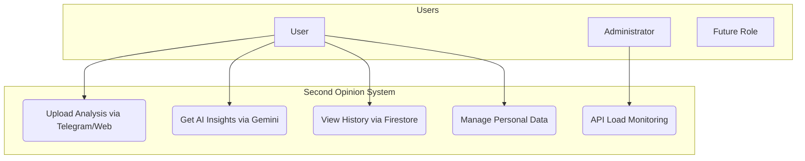
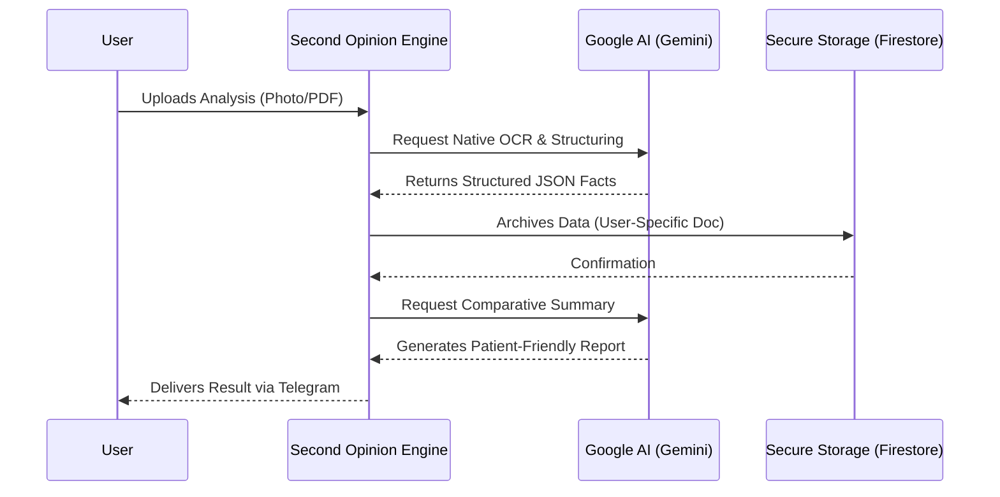
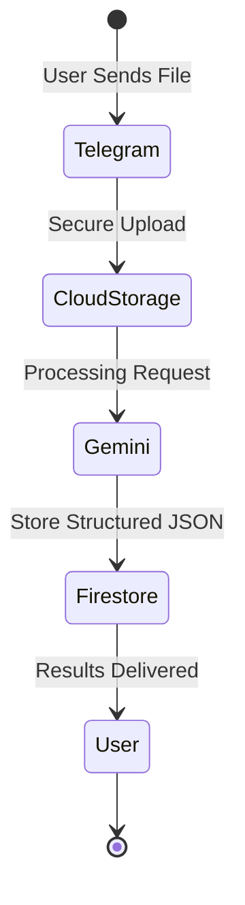

# Second Opinion: AI Infrastructure Overview

This document describes the high-level architecture of the "Second Opinion" ecosystem. The system is designed for maximum scalability, data privacy, and cost-efficiency.

# 1. Architectural Layers

To understand how the system operates, we divide it into three distinct layers:

Infrastructure Layer (The Foundation):

Google Cloud & Firebase: Provides serverless computing, secure document storage (Firestore), and encrypted file hosting (Cloud Storage). This is where the data "lives."

Intelligence Layer (The Brain):

Google Gemini 2.5 Flash: The generative AI engine responsible for OCR, medical data structuring, and semantic analysis. It processes but does not permanently store user data.

Interface Layer (The Gateway):

Telegram Bot API: Our primary mobile interface for instant user engagement.

React Web Portal: A secondary interface for desktop users and data visualization.

# 2. Business Use Cases

Use Case Diagram

# 3. System Flow (Sequence Diagram)

How data moves between components in real-time.

# 4. Document Lifecycle (State Diagram)

State Diagram v2

# 5. The Technology Stack

Cloud Ecosystem: Google Firebase (NoSQL database, Auth, Storage).

AI Engine: Google Gemini API (High-performance multimodal LLM).

Messenger API: Telegram (Universal delivery channel).

# 6. Security Principles

End-to-End Logic: Data is encrypted during transit from Telegram to Google Cloud.

User Isolation: Firestore rules ensure that a user can only access data associated with their unique Telegram ID.

Data Sovereignty: Users can trigger a full wipe of their medical records via a simple command.

Metadata: Updated April 2024 | Author: M. M. Bolshedvorskii